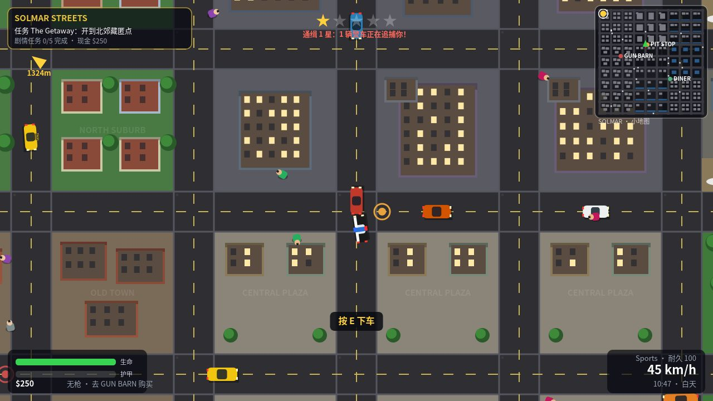
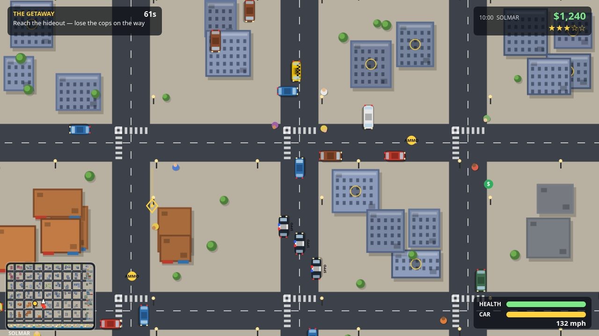
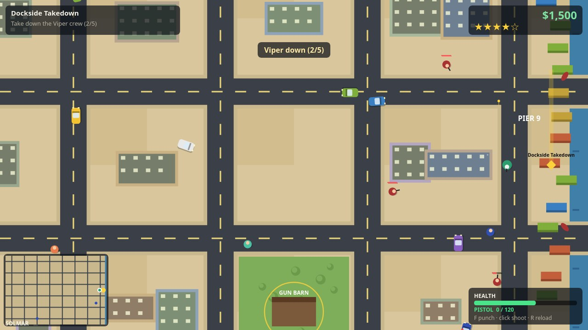
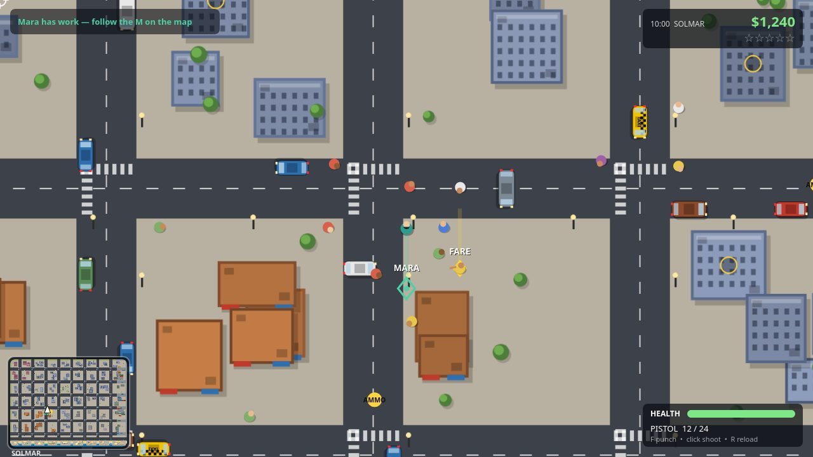

# SOLMAR STREETS

[](https://make.fun/bounty/gta6-01?utm_source=github&utm_medium=readme&utm_campaign=gta6-01)
[](https://make.fun/bounty/gta6-01/leaderboard?utm_source=github&utm_medium=readme&utm_campaign=gta6-01)
[](https://make.fun/bounty/gta6-01?utm_source=github&utm_medium=readme&utm_campaign=gta6-01)

An open-world crime game set in **Solmar**, a sun-soaked coastal city of your
own making. You are **Jax Carter**, a wheelman for hire. Steal cars, outrun
the Solmar PD, run jobs for the fixer **Mara Voss**, and build your name —
one getaway at a time.

Everything is original: the city, the characters, the vehicles, the story,
the art and the sound. No Rockstar material anywhere.

## In the game






## The city

Six districts, one map, on foot and behind the wheel:

- **Downtown** — glass towers, the Gun Barn, the busiest traffic in Solmar
- **Old Town** — brick streets, Mara's hideout, tight corners for getaways
- **Portside** — docks, warehouses and containers, home of the Viper crew
- **Palma Beach** — sand, surf and the long coastal boulevard
- **The Hills** — mansions, gates and long driveways
- **Industrial** — the Pit Stop garage and wide, empty service roads

Between them: a park with a fountain, streetlights on every road, a wooden
pier and a lighthouse on the beach, and a Falcon S parked around Downtown
for anyone with a fast-car habit.

## What you can do

- **Explore on foot or by car** — walk, run, jack parked cars or steal one
  out of traffic, drive anything with four wheels
- **Traffic and pedestrians** — cars follow the roads, pedestrians walk the
  sidewalks and scatter when shots ring out; honk (H) to clear your way
- **Wanted level** — 0 to 5 stars. Steal in sight of the law, hit a
  pedestrian or open fire and the Solmar PD responds: cruisers chase, ram
  and try to box you in. Lay low and the heat cools off; finish a job for
  Mara and she has it called off entirely
- **Story missions** — three jobs from Mara: *The Getaway* (steal the Comet
  GT and lose the cops), *Hot Delivery* (a package, a timer, the whole city
  in the way), *Dockside Takedown* (clear the Viper crew off the docks).
  Finish all three and Mara keeps the work coming: *Quick Getaway*, a
  repeatable car job for $300 a run
- **Side work** — taxi fares: pick up a waving pedestrian, drop them off,
  get paid; thread past traffic at speed for a close-call bonus
- **Combat** — fists up close, pistol at range, ammo and repairs to buy
- **Progression** — cash from jobs and fares, a save system (localStorage)
  that keeps your money, your missions and your place in the city, plus
  cross-run totals that never reset
- **HUD and minimap** — cash, health, wanted stars, objective card, speed
  and a live minimap with mission markers, police blips and fares

## Mission walkthrough

1. **The Getaway** — Talk to Mara at the hideout (follow the green M).
   Any car gets you to Palma Blvd, but the Comet GT is the prize. Touch it
   and the SPPD comes: break line of sight, let the stars cool, then bring
   it home before the 100-second timer runs out.
2. **Hot Delivery** — Pick up the package at Warehouse 7, Portside, and run
   it to Villa Solana in The Hills in 120 seconds. Take the coastal road
   east, then cut north; brake before the Hills corners.
3. **Dockside Takedown** — Get to Pier 9, then clear five armed Vipers.
   Fight on foot with the pistol and use the containers as cover — they
   shoot back, and the Comet's bullets do not reach them from the car.

## Tips from the streets

- The Comet GT is the fastest car in Solmar, but any car finishes a job —
  a stolen taxi is a quieter getaway than a red sports car.
- The heat cools only when no cruiser can see you: break line of sight
  down a side street, then wait out the stars.
- Thread past traffic at speed for a close-call bonus, and drop a fare off
  with half the timer left for a tip.
- The Pit Stop is cheaper than a new car. Buy ammo at the Gun Barn before
  Pier 9 — five Vipers drink a magazine fast.

## Controls

| Key | Action |
| --- | --- |
| WASD / arrows | Move on foot, drive (W accelerate, S brake/reverse, A/D steer) |
| Shift | Sprint on foot |
| Space | Handbrake |
| E | Enter / exit car, talk, buy, interact |
| F | Punch (on foot) |
| Mouse + click | Aim and shoot the pistol (R reloads) |
| H | Honk the horn |
| P / Esc | Pause (S saves, R restarts, Q quits to title) |
| M | Mute |
| T | Show the frame rate |

## How to run

Serve `game/` with any static HTTP server and open `index.html` in a desktop
browser:

```sh
cd game && python3 -m http.server 8123
# open http://127.0.0.1:8123/index.html
```

No build step, no libraries, no network requests. Everything the game loads
is a file under `game/`. Sound is synthesized live with WebAudio.

## Layout

- `main.ts` — hands the entry in: copies `game/` and `screenshots/` to the
  output directory and writes `dossier.json` with the vendored make.fun
  library; it refuses screenshots over the 256 KiB cap, and refuses any
  screenshot that is not a real JPEG (it checks the magic bytes)
- `game/src/config.js` — tuning, car models, districts and mission text
- `game/src/city.js` — the city: roads, blocks, buildings, beach, docks,
  park, fountain, lighthouse, pier and streetlights
- `game/src/world.js` — the simulation: player, traffic, police, wanted
- `game/src/missions.js` — story missions, the repeat job and taxi fares
- `game/src/entities.js` — cars, pedestrians, bullets and particles
- `game/src/render.js` — the camera, the city, the HUD and the minimap
- `game/src/audio.js` — synthesized sound effects and music
- `game/src/input.js` — keyboard and mouse
- `game/src/save.js` — localStorage save, load and cross-run totals
- `game/src/shots.js` — deterministic staged scenes for screenshots
- `game/src/main.js` — boot, the frame loop and the screen state machine

## Development

The playtest drivers live in `../tools/` (outside the entry): `playtest2.js`
runs the full campaign (m1 → m2 → gun barn → pit stop → m3 → taxi) with real
keyboard and mouse in headed Firefox under Xvfb, and `shoot.js` retakes the
four screenshots. Serve `game/` on port 8123 first, then:

```sh
xvfb-run -a -s "-screen 0 1280x720x24" node ../tools/shoot.js
xvfb-run -a -s "-screen 0 1280x720x24" node ../tools/playtest2.js
```

## Known limits

- Desktop browser only: the game is tuned for keyboard and mouse. There is
  no touch control scheme.
- One save slot, kept in the browser's localStorage. Clearing site data
  wipes the save (cross-run totals go with it).
- The world is a single fixed map of 3600×2700 px. There is no day/night
  cycle and no weather.
- Screenshots are staged scenes (`?shot=…`) so the entry's images are
  reproducible; the game itself is fully playable from the title screen.

## Credits

Built for the make.fun **gta6-01** bounty ("Make GTA 6") by Korn Shay.
All code, art, story and sound are original and written for this entry.
